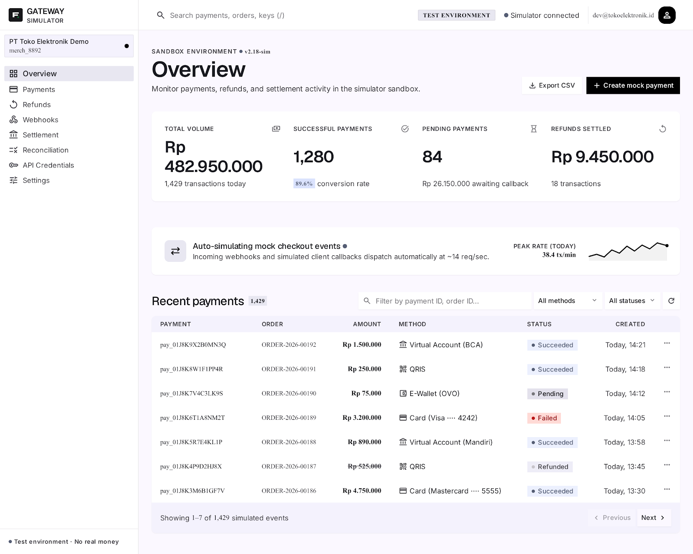

# Modular Payment Gateway & Merchant Dashboard

<p align="center">
  
</p>

Aplikasi web full-stack modular payment gateway dan merchant dashboard yang terinspirasi dari arsitektur platform pembayaran modern seperti Midtrans, Xendit, dan Stripe. Dilengkapi dengan state machine pembayaran, sistem rekonsiliasi & settlement, idempotency controls, webhook engine berorientasi keamanan (mitigasi SSRF & DNS Rebinding), serta audit logging berstandar enterprise.

**Portfolio Engineering Project — Financial Infrastructure & Payment Systems Simulation**

---

## Konfigurasi Aplikasi

### Persyaratan Sistem
| Komponen | Versi | Keterangan |
|----------|-------|------------|
| Node.js | 20+ / 24+ | Runtime JavaScript / TypeScript |
| npm | 9+ / 10+ | Node Package Manager |
| PostgreSQL | 15+ / 16+ | Database Relasional Utama |
| Docker & Compose | 24+ | Opsional untuk containerized setup |

### Database (PostgreSQL)

Aplikasi menggunakan **PostgreSQL** untuk memastikan integritas data finansial, isolasi multi-tenant antar merchant, dan transaksi atomik dengan ACID compliance.

Konfigurasi koneksi ada di `backend/.env` (dapat disalin dari [backend/.env.example](backend/.env.example)):

```properties
NODE_ENV=development
PORT=3000

# PostgreSQL Configuration
DB_HOST=localhost
DB_PORT=5432
DB_USERNAME=paymentgw
DB_PASSWORD=paymentgw_secret
DB_NAME=payment_gateway

# Feature Flags (Development Mode)
ALLOW_DEV_CREDENTIAL_PROVISIONING=true
ALLOW_DEV_PAYMENT_SIMULATION=true
ALLOW_DEV_WEBHOOK_DELIVERY=true
ALLOW_DEV_LOCAL_WEBHOOKS=true
```

> Skema tabel dikelola secara terkontrol menggunakan **TypeORM Migrations** (`synchronize: false` untuk menjaga integritas skema produksi).

### Menjalankan Aplikasi

**1. Opsi Docker Compose (Paling Cepat):**
```bash
docker compose up -d --build
```
> Menjalankan seluruh stack secara otomatis:
> - **PostgreSQL**: port `5432`
> - **Backend NestJS (API & Docs)**: port `3005`
> - **Frontend Next.js (Dashboard)**: port `3001`

**2. Opsi Manual / Bare-Metal:**

**Backend (NestJS — port 3000):**
```bash
cd backend
npm install
npm run migration:run
npm run start:dev
```

**Frontend (Next.js App Router — port 3001):**
```bash
cd frontend
npm install
npm run dev -- -p 3001
```

Akses aplikasi di:
- **Merchant Dashboard (Frontend):** `http://localhost:3001`
- **REST API & Swagger Docs (Backend):** `http://localhost:3005/docs`
- **Health Check Endpoint:** `http://localhost:3005/health`

---

## Akun yang Tersedia & Kredensial Pengujian

Autentikasi merchant menggunakan format **Bearer API Key** (`sk_test_...` atau `sk_live_...`).

### Kredensial Pengujian

| Tipe Kredensial | Format Key | Kegunaan |
|-----------------|------------|----------|
| **Test Mode Key** | `sk_test_<random_alphanumeric>` | Simulasi pembayaran sandbox (QRIS, VA, E-Wallet, Card) |
| **Live Mode Key** | `sk_live_<random_alphanumeric>` | Operasi merchant terisolasi |
| **Public Key** | `pk_test_<random_alphanumeric>` | Identifikasi frontend client |

> **Cara Mendapatkan Kredensial:**  
> Pada mode development, Anda dapat membuat merchant baru dan memperoleh API Key rahasia melalui development endpoint:
> ```bash
> # 1. Buat Merchant
> curl -X POST http://localhost:3000/api/v1/merchants -H "Content-Type: application/json" -d '{"name":"Merchant Demo","businessName":"PT Demo Finansial","email":"merchant@demo.com"}'
>
> # 2. Generate API Key (catat secretKey karena hanya ditampilkan sekali)
> curl -X POST http://localhost:3000/api/v1/internal/merchants/<MERCHANT_ID>/api-credentials
> ```
> Masukkan `secretKey` tersebut ke modal login dashboard di `http://localhost:3001`.

---

## Fitur Utama

| Fitur | Endpoint Frontend | Deskripsi |
|-------|-------------------|-----------|
| **Merchant Login** | `/` (Auth Modal) | Autentikasi merchant berbasis API Key dengan validasi `/auth/me` |
| **Overview Dashboard** | `/overview` | Monitoring volume pembayaran, success rate, dan statistik real-time |
| **Transaksi Pembayaran** | `/payments` | Daftar transaksi, filter status (`PENDING`, `SUCCEEDED`, `FAILED`, `EXPIRED`) |
| **Detail Pembayaran** | `/payments/[id]` | Inspeksi rincian pembayaran, order ID, metode bayar, dan audit log |
| **Manajemen Refund** | `/refunds` | Pembuatan dan pelacakan pengembalian dana (penuh atau sebagian) |
| **Settlement Dashboard** | `/settlement` & `/settlement/[id]` | Rekapitulasi siklus pencairan dana merchant dengan perhitungan potongan biaya |
| **Rekonsiliasi Finansial**| `/reconciliation` & `/[id]` | Pencocokan data transaksi internal dengan mutasi bank eksternal ($O(N+M)$) |
| **Webhook Delivery** | `/webhooks` | Manajemen endpoint notifikasi, audit pengiriman HTTP, dan payload inspection |
| **API Credentials** | `/api-credentials`| Manajemen API Key (pembuatan key baru, revocasi key lama, dan status) |
| **Pengaturan Merchant**| `/settings` | Profil bisnis, webhook signing secret, dan konfigurasi lingkungan |

---

## Arsitektur

```
PaymentGateway/
├── backend/                               # NestJS Modular Monolith
│   ├── src/
│   │   ├── auth/                          # API Key authentication, hashing, & guards
│   │   ├── common/                        # Shared cross-cutting concerns
│   │   │   ├── filters/                   # Centralized exception filters
│   │   │   ├── interceptors/              # Structured logging & execution timing
│   │   │   ├── logger/                    # PII/PAN data masking structured logger
│   │   │   ├── metrics/                   # In-memory Prometheus-ready metrics collector
│   │   │   └── middleware/                # Correlation ID (X-Request-Id) tracing
│   │   ├── database/                      # TypeORM data source & migration scripts
│   │   ├── health/                        # Liveness & readiness probes
│   │   ├── merchant/                      # Multi-tenant merchant isolation domain
│   │   ├── payment/                       # Payment state machine & simulator
│   │   │   ├── controllers/               # REST API endpoints
│   │   │   ├── entities/                  # TypeORM entities (Payment, IdempotencyKey)
│   │   │   ├── providers/                 # Simulated external bank/e-wallet provider
│   │   │   └── services/                  # Business logic (Payment & Idempotency)
│   │   ├── reconciliation/                # Two-way reconciliation algorithm engine
│   │   ├── refund/                        # Refund processing & balance verification
│   │   ├── settlement/                    # Merchant settlement calculation engine
│   │   └── webhook/                       # Webhook dispatcher & SSRF security defense
│   ├── test/                              # End-to-End (E2E) integration test suites
│   ├── Dockerfile                         # Production backend container definition
│   └── package.json
├── frontend/                              # Next.js 15 (App Router) + React 19
│   ├── src/
│   │   ├── app/                           # App Router pages & sub-routes
│   │   ├── components/                    # Modular UI component library
│   │   │   ├── auth/                      # API Key login modal
│   │   │   ├── payments/                  # Create payment & refund interactive modals
│   │   │   ├── shell/                     # Brutalist sidebar & top navigation bar
│   │   │   └── ui/                        # Reusable badges, buttons, cards, tables
│   │   ├── lib/                           # API client (fetch wrapper) & Auth Context
│   │   ├── styles/                        # Tailwind CSS global styles & Brutalist tokens
│   │   └── types/                         # Strongly-typed domain & API contracts
│   └── package.json
├── design/                                # UI/UX Mockups & Architecture diagrams
├── docker/                                # Docker PostgreSQL initialization scripts
├── docker-compose.yml                     # Multi-container orchestration
└── README.md
```

---

## Konsep Engineering yang Diimplementasikan

### 1. Idempotency & Concurrency Control
- **Pessimistic Locking (`FOR UPDATE`)**: Mencegah race condition ketika terdapat request pembayaran atau refund ganda yang masuk secara simultan.
- **Idempotency Key Engine**: Header `Idempotency-Key` disimpan secara atomik pada database PostgreSQL. Request duplikat akan mengembalikan respons yang sama persis tanpa mengeksekusi mutasi ulang.

### 2. Integritas Finansial & Non-Calculation Invariant
- **Presisi Moneter Integer (`BIGINT`)**: Seluruh nilai moneter disimpan dalam satuan mata uang terkecil (Rupiah integer). Tidak menggunakan floating-point math untuk menghindari rounding error.
- **Frontend Non-Calculation Invariant**: Frontend dilarang keras merekayasa atau menghitung ulang nilai settlement/pajak; backend merupakan otoritas tunggal atas kalkulasi finansial.
- **Append-Only Auditing**: Rekonsiliasi bekerja secara non-destruktif tanpa memodifikasi transaksi asal.

### 3. Keamanan Tingkat Lanjut & Mitigasi Vulnerability
- **SSRF & DNS Rebinding / TOCTOU Mitigation**: Sistem pengiriman webhook memverifikasi resolusi DNS, memblokir rentang IPv4/IPv6 privat (`10.0.0.0/8`, `192.168.0.0/16`, `127.0.0.1`, cloud metadata `169.254.169.254`), serta mengunci koneksi HTTP menggunakan *pinned IP address* untuk menggagalkan time-of-check to time-of-use exploit.
- **Cryptographic Signature**: Payload webhook ditandatangani menggunakan **HMAC SHA-256** dengan secret per-merchant untuk memvalidasi integritas pesan.
- **Automated PII/PAN Redaction**: Structured JSON logger secara otomatis menyamarkan data sensitif (*card number, CVV, password, API secret, Bearer token*) pada berbagai format penamaan (*camelCase*, *snake_case*, *kebab-case*).

### 4. Algoritma Rekonsiliasi & Pencegahan Algorithmic DoS
- **Pencocokan Rekonsiliasi $O(N+M)$**: Algoritma pencocokan dua arah antara data transaksi internal dengan rekening koran bank menggunakan struktur data map/set terindeks.
- **Strict Window Bounding**: Input rentang tanggal rekonsiliasi dibatasi maksimum 31 hari untuk mencegah degradasi performa (*algorithmic denial of service*).

### 5. Observabilitas & Post-Commit Transaction Boundary
- **Request Tracing**: Setiap request diberikan `X-Request-Id` unik yang diteruskan melalui konteks asinkron (`AsyncLocalStorage`).
- **Post-Commit Lifecycle Events**: Event lifecycle (`payment.created`, `payment.succeeded`) dieksekusi secara ketat *setelah* transaksi database berhasil di-`COMMIT`, memastikan event tidak pernah terkirim jika transaksi mengalami `ROLLBACK`.

---

## Dependency & Tools

### Backend
- **NestJS v10**: Progressive Node.js framework untuk arsitektur modular enterprise
- **TypeORM**: Object-Relational Mapper dengan migrasi database deterministik
- **PostgreSQL 16**: Relational Database Management System
- **TypeScript**: Static typing untuk keamanan tipe lintas domain
- **Jest & Supertest**: Unit testing dan integration E2E testing framework
- **Swagger / OpenAPI**: Spesifikasi dan dokumentasi API interaktif
- **Docker**: Containerization database dan backend

### Frontend
- **Next.js 15 (App Router)**: React Framework untuk performa dan server/client component boundary
- **React 19**: Modern UI rendering engine
- **Tailwind CSS**: Utility-first CSS dengan desain *Technical Web Brutalism*
- **Lucide React**: Icon set bersih dan konsisten
- **Vitest & React Testing Library**: Framework pengujian unit dan komponen frontend

---

## Instalasi & Setup Detail

### Langkah 1: Setup Database
Pastikan PostgreSQL sedang berjalan, atau jalankan menggunakan Docker:
```bash
docker run --name pg-payment-gateway -e POSTGRES_USER=paymentgw -e POSTGRES_PASSWORD=paymentgw_secret -e POSTGRES_DB=payment_gateway -p 5432:5432 -d postgres:16-alpine
```

### Langkah 2: Setup Backend
```bash
cd backend
npm install
npm run build
npm run migration:run
npm run start:dev
```
Backend akan aktif di `http://localhost:3000`.

### Langkah 3: Setup Frontend
Buka terminal baru:
```bash
cd frontend
npm install
npm run dev -- -p 3001
```
Frontend akan aktif di `http://localhost:3001`.

### Langkah 4: Akses Aplikasi
Buka browser dan akses:
- Dashboard: `http://localhost:3001`
- Swagger API Docs: `http://localhost:3000/docs`

---

## API Endpoints

### Autentikasi & Merchant
- `POST /api/v1/merchants` - Pendaftaran merchant baru
- `GET /api/v1/merchants/:id` - Mendapatkan profil merchant
- `GET /api/v1/auth/me` - Verifikasi kredensial API Key yang aktif
- `POST /api/v1/internal/merchants/:id/api-credentials` - Pembuatan API Key baru (Dev mode)

### Pembayaran (Payments)
- `POST /api/v1/payments` - Membuat transaksi pembayaran baru (Mendukung `Idempotency-Key`)
- `GET /api/v1/payments` - Mendapatkan daftar transaksi merchant (terfilter & terpaginasi)
- `GET /api/v1/payments/:id` - Mendapatkan rincian transaksi berdasarkan ID
- `POST /api/v1/internal/payments/:id/simulate` - Simulasi pembayaran berhasil/gagal oleh provider

### Pengembalian Dana (Refunds)
- `POST /api/v1/refunds` - Mengajukan refund pembayaran (Full atau Partial)
- `GET /api/v1/refunds` - Mendapatkan daftar riwayat refund
- `GET /api/v1/refunds/:id` - Mendapatkan detail refund tertentu

### Settlement & Rekonsiliasi
- `POST /api/v1/settlements/calculate` - Kalkulasi settlement periodik untuk merchant
- `GET /api/v1/settlements` - Mendapatkan riwayat batch settlement
- `GET /api/v1/settlements/:id` - Mendapatkan rincian settlement dan transaksi terkait
- `POST /api/v1/reconciliations` - Menjalankan proses rekonsiliasi dua arah (rentang maks. 31 hari)
- `GET /api/v1/reconciliations` - Mendapatkan riwayat audit rekonsiliasi
- `GET /api/v1/reconciliations/:id` - Mendapatkan rincian discrepancy rekonsiliasi

### Webhook Engine
- `POST /api/v1/webhooks/configurations` - Mendaftarkan URL webhook merchant
- `GET /api/v1/webhooks/deliveries` - Mendapatkan log audit pengiriman webhook
- `POST /api/v1/internal/webhooks/deliveries/:id/trigger` - Menjalankan retry pengiriman webhook secara manual

### System Health
- `GET /health/live` - Liveness probe status backend
- `GET /health/ready` - Readiness probe konektivitas database

---

## File Penting

| File | Deskripsi |
|------|-----------|
| [payment.service.ts](backend/src/payment/services/payment.service.ts) | State machine pembayaran & post-commit event boundaries |
| [idempotency.service.ts](backend/src/payment/services/idempotency.service.ts) | Transaksi atomik & pencegahan eksekusi duplikat |
| [webhook-delivery.service.ts](backend/src/webhook/services/webhook-delivery.service.ts) | Webhook dispatcher dengan mitigasi SSRF & pinned IP |
| [reconciliation.service.ts](backend/src/reconciliation/services/reconciliation.service.ts) | Algoritma rekonsiliasi finansial $O(N+M)$ |
| [settlement.service.ts](backend/src/settlement/services/settlement.service.ts) | Kalkulasi pencairan dana & resolusi saldo merchant |
| [structured-logger.service.ts](backend/src/common/logger/structured-logger.service.ts) | JSON logger dengan normalisasi & sensor data sensitif |
| [api-client.ts](frontend/src/lib/api-client.ts) | HTTP client frontend dengan penanganan otomatis headers |
| [auth-context.tsx](frontend/src/lib/auth-context.tsx) | Manajemen sesi kredensial API Key di frontend |

---

## Troubleshooting

### Backend Error: "Port 3000 already in use"
```bash
# Ubah port di backend/.env
PORT=3002
```

### Database Connection Error: "Connection refused 5432"
Pastikan service PostgreSQL berjalan dan port `5432` dapat diakses:
```bash
docker ps
# Pastikan container 'postgres' berstatus Up (healthy)
```

### Webhook Delivery Gagal di Localhost: "SSRF Blocked"
Secara default, engine webhook memblokir alamat lokal (`127.0.0.1` / `localhost`) demi keamanan. Untuk keperluan pengujian lokal, pastikan variabel berikut aktif di `backend/.env`:
```properties
ALLOW_DEV_LOCAL_WEBHOOKS=true
```

### Reset Database & Jalankan Ulang Migrasi
```bash
cd backend
npm run migration:revert
npm run migration:run
```

---

## Build & Deployment

### Build Frontend
```bash
cd frontend
npm run build
# Hasil build tersimpan di folder .next/
```

### Build Backend
```bash
cd backend
npm run build
# Hasil build tersimpan di folder dist/
```

### Run Production Container
```bash
docker compose up -d --build
```

---

## Pengujian & Verifikasi Kualitas

Sistem ini dilengkapi dengan pengujian berlapis yang mencakup unit testing, concurrency validation, dan integration testing:

```bash
# Pengujian Backend (Unit Tests — 123 tests)
cd backend
npm run test

# Pengujian Backend (End-to-End Tests — 99 tests)
npm run test:e2e

# Linting Backend (0 errors)
npm run lint

# Pengujian Frontend (Vitest — 68 tests)
cd ../frontend
npm run test

# Linting Frontend (0 errors)
npm run lint
```

---

## Tim Pengembang

Dikembangkan sebagai **Advanced Engineering Showcase & Portfolio Project** yang mendemonstrasikan implementasi sistem pemrosesan finansial, mitigasi kerentanan keamanan siber, dan arsitektur web modern skala industri.

---

## License & Disclaimer

Proyek ini dibuat secara mandiri murni untuk **tujuan edukasi dan portofolio teknis**.

> **Pernyataan Penyangkalan (Disclaimer):**  
> Sistem ini **BUKAN** pemroses pembayaran berlisensi riil, tidak terhubung ke bank sebenarnya, dan tidak memproses uang nyata. Sistem ini **TIDAK** mengklaim kepatuhan PCI DSS dan tidak menyimpan data kartu kredit fisik/CVV asli (seluruh data transaksi kartu disimulasikan).

---

**Terakhir Diperbarui**: Oktober 2026  
**Status**: Ready for Portfolio & Production-Simulation Showcase
